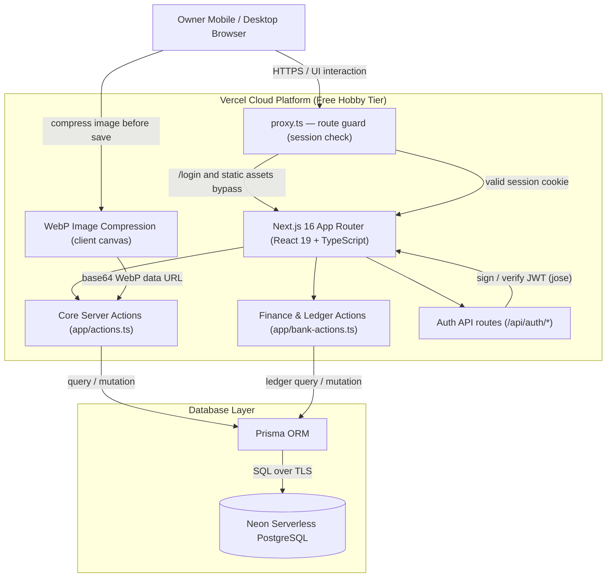
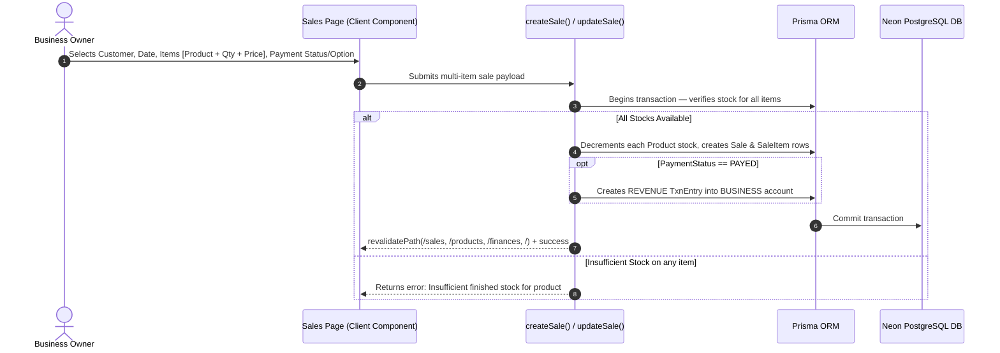
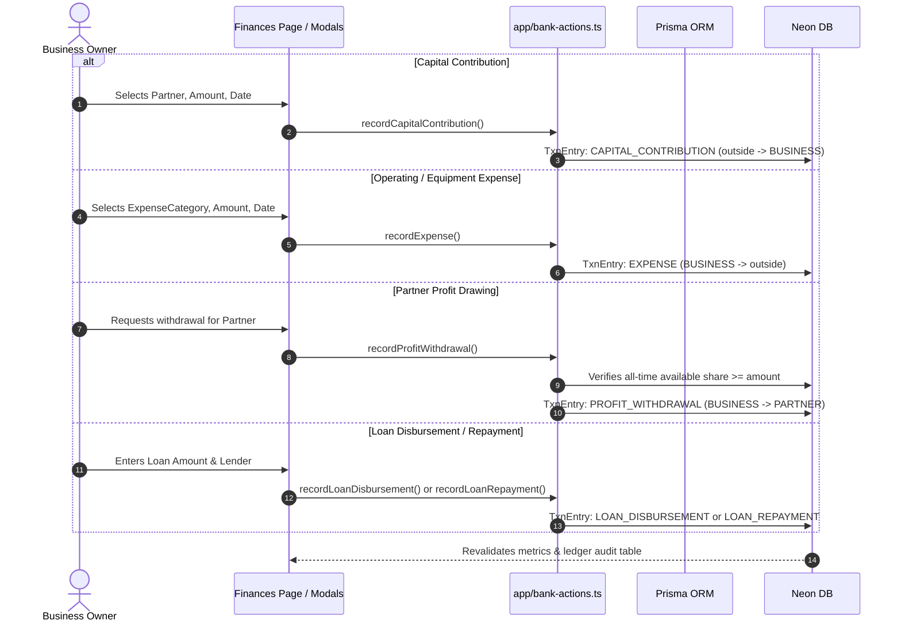
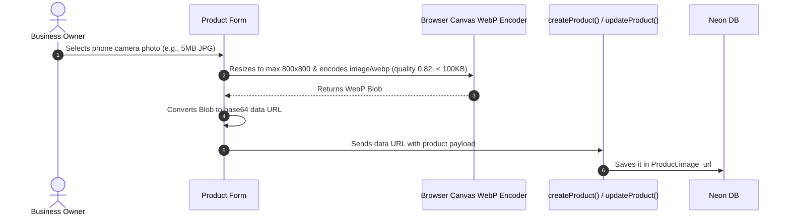
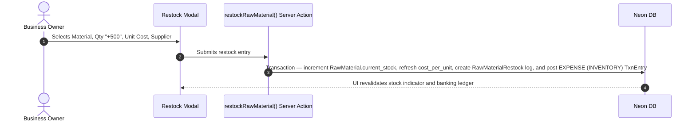

# System Architecture Document

## System Overview: Invento Architecture

**Invento** is built as a serverless, cloud-native web application deployed on **Vercel** with a **Neon PostgreSQL** database layer. All mutations go through Next.js Server Actions backed by Prisma transactions.



---

## 1. Tech Stack Components

| Layer | Component | Description |
| :--- | :--- | :--- |
| **Framework** | **Next.js 16 (App Router, Turbopack)** | Server Components for dashboard/finances SSR, Client Components for interactive modals/tables, Server Actions for mutations. |
| **Route Guard** | **`proxy.ts`** | Next.js 16 request interceptor (middleware replacement) verifying the session cookie on every route. |
| **Frontend UI** | **React 19 + TypeScript** | Client-side pages with optimistic local state around Server Action calls. |
| **Styling** | **Tailwind CSS v4 + lucide-react** | Geist design tokens defined in `app/globals.css` (`@theme`), light/dark variants, responsive mobile-first grids. |
| **Backend & API** | **Next.js Server Actions** | Type-safe mutations split between `app/actions.ts` (inventory, sales, production) and `app/bank-actions.ts` (double-entry ledger, expenses, loans), wrapped in `prisma.$transaction`. |
| **Auth** | **`jose` (HS256 JWT) + `bcrypt-ts`** | Database-backed `User` authentication with salted bcrypt hashes; stateless signed session cookies (7 days); first-run onboarding wizard. |
| **Database ORM** | **Prisma ORM** | Schema-driven, type-safe client; singleton in `lib/prisma.ts`. |
| **Database** | **Neon PostgreSQL** | Serverless cloud Postgres via pooled `DATABASE_URL`. |
| **Image Optimizer** | **Canvas → WebP (`lib/webp-compressor.ts`)** | Client-side resize to ≤ 800×800 and WebP encode (< 100 KB) before saving the data URL on the product record. |
| **Fonts** | **Geist Sans / Geist Mono** | Loaded via `next/font/google` in the root layout. |

---

## 2. Component Layering & Data Flow

### A. Customer Sale & Stock Flow


Editing a sale (`updateSale`) re-balances stock across modified `SaleItem` rows inside a transaction, adjusting stock deltas and syncing `REVENUE`/`REFUND` entries in the banking ledger if status or amount changes.

### B. Banking & Double-Entry Ledger Flow


### C. Image Upload & WebP Optimization Flow


### D. Raw Material Restock Flow


### E. Batch Production (V2) + Maceration Flow
```mermaid
sequenceDiagram
    autonumber
    actor Owner as Business Owner
    participant UI as Production Page (Client)
    participant Action as produceBatchV2() Server Action
    participant DB as Neon DB

    Owner->>UI: Chooses bottle/mass mode, quantity, concentration, materials, maceration days
    UI->>UI: Live-calculates oil (g) & ethanol (ml); blocks if any material is short
    UI->>Action: Submits production payload
    Action->>DB: Transaction — verify & deduct oil/ethanol (+ optional bottle/box/sticker)
    alt Maceration days > 0
        Action->>DB: Create MacerationBatch (MACERATING) — stock NOT incremented
    else No maceration
        Action->>DB: Increment Product.stock directly
    end
    Action->>DB: Write BatchProduction log
    DB-->>UI: Revalidate /products, /raw-materials, /maceration, /
```

Releasing an aged batch (`addMacerationToStock`) increments `Product.stock` and flips the batch to `ADDED_TO_STOCK`; `extendMaceration` pushes the end date out instead.

### F. Authentication & First-Run Onboarding Flow
```mermaid
sequenceDiagram
    autonumber
    actor Owner as Business User
    participant Guard as proxy.ts
    participant Setup as /setup (First-Run)
    participant Login as /login Page
    participant API as /api/auth/login
    participant DB as Neon DB (User table)
    participant App as Protected Pages

    alt First-Run (0 Users in DB)
        Owner->>Guard: Navigates to app
        Guard->>Login: Redirects unauthenticated visitor
        Login->>Setup: checkNeedsSetup() detects 0 users -> redirect /setup
        Owner->>Setup: Enters Name, Admin Username, Password
        Setup->>DB: Hashes with salted bcrypt, creates User, creates JWT session
        Setup->>App: Lands on Dashboard
    else Standard Login
        Owner->>Login: Enters username + password
        Login->>API: POST credentials
        API->>DB: Queries User record & verifies bcrypt hash
        API-->>Login: Sets httpOnly invento-session cookie (HS256 JWT, 7 days)
        Login->>App: Redirect to requested page
    end
    Note over Guard: Verifies token signature via AUTH_SECRET;<br/>missing/invalid token -> redirect to /login
```

---

## 3. Server Action Surface

### Core Domain Actions (`app/actions.ts`)

| Group | Actions |
|-------|---------|
| **Products** | `getProducts`, `createProduct`, `updateProduct`, `updateProductStock`, `deleteProduct` |
| **Sales** | `getSales` (filterable), `createSale`, `updateSale`, `updateSalePaymentStatus`, `toggleSaleReview`, `deleteSale` |
| **Raw Materials** | `getRawMaterials`, `createRawMaterial`, `updateRawMaterial`, `restockRawMaterial`, `deleteRawMaterial` |
| **Recipes & Production** | `getRecipes`, `getRecipesForProduct`, `saveRecipe`, `produceBatch` (V1), `produceBatchV2` |
| **Maceration** | `getMacerationBatches`, `createMacerationBatch`, `addMacerationToStock`, `extendMaceration`, `getCompletedMacerations`, `deleteMacerationBatch` |
| **Dashboard Metrics** | `getDashboardMetrics` |

### Finance & Banking Ledger Actions (`app/bank-actions.ts`)

| Group | Actions |
|-------|---------|
| **Accounts** | `getOrCreateDefaultAccounts`, `updatePartnerShares` |
| **Capital & Drawings** | `recordCapitalContribution`, `recordProfitWithdrawal` |
| **Operating Costs** | `recordExpense` (with `ExpenseCategory` support) |
| **Financing & Debt** | `recordLoanDisbursement`, `recordLoanRepayment` |
| **Reporting & Ledger** | `getBankMetrics` (supports month/year and `isAllTime`), `getLedger` (paginated audit log), `getCurrentPKTYearMonth` |

### User Management Actions (`app/user-actions.ts`)

| Group | Actions |
|-------|---------|
| **Onboarding & Setup** | `checkNeedsSetup`, `setupInitialAdmin` |
| **Team Management** | `getUsers`, `createUser`, `deleteUser` |
| **Security** | `changePassword` |

Transaction-backed (stock & ledger safe) actions: `createSale`, `updateSale`, `updateSalePaymentStatus`, `deleteSale`, `restockRawMaterial`, `produceBatch`, `produceBatchV2`, `createMacerationBatch`, `addMacerationToStock`, `extendMaceration`, `saveRecipe`, `recordCapitalContribution`, `recordExpense`, `recordProfitWithdrawal`, `recordLoanDisbursement`, `recordLoanRepayment`, `setupInitialAdmin`.

---

## 4. Directory & File Structure

```
invento/
├── app/
│   ├── layout.tsx                     # Root layout: Geist fonts, pre-paint theme script, Navbar
│   ├── page.tsx                       # Dashboard (server component, revalidate = 0)
│   ├── globals.css                    # Geist design tokens (@theme) + light/dark styles
│   ├── actions.ts                     # Core domain server actions (products, sales, raw materials, batch)
│   ├── bank-actions.ts                # Double-entry ledger and finance server actions
│   ├── user-actions.ts                # User management, setup wizard, and password actions
│   ├── api/
│   │   ├── auth/login/route.ts        # POST — verify credentials against DB, set session cookie
│   │   └── auth/logout/route.ts       # POST — clear session cookie
│   ├── batch-production/              # V1 recipe-based production (legacy, not in nav)
│   ├── batch-production-v2/           # V2 concentration-based production (nav "Production")
│   ├── finances/                      # Cash-basis profit & ledger page
│   ├── login/                         # Sign in page (with auto-redirect to setup if 0 users)
│   ├── setup/                         # First-run onboarding wizard (creates initial admin)
│   ├── settings/                      # User management & password change page
│   ├── maceration/                    # Maceration management
│   ├── products/                      # Product catalog (grid, CRUD, image upload)
│   ├── raw-materials/                 # Raw materials inventory + restock intake
│   └── sales/                         # Sales register (multi-item orders, filters, CRUD)
├── components/
│   ├── CalendarDatePicker.tsx         # Custom calendar popover date picker
│   ├── MacerationAlertCards.tsx       # Dashboard maceration release/extend cards
│   ├── Navbar.tsx                     # Top nav + mobile bottom bar with "More" drawer overlay
│   ├── ThemeToggle.tsx                # Light/dark toggle (localStorage `invento-theme`)
│   └── finances/                      # Finance & banking ledger UI components
│       ├── CapitalContributionModal.tsx # Record partner capital injections
│       ├── FinancesClient.tsx         # Main interactive client controller for finances
│       ├── LedgerTable.tsx            # Filterable, paginated audit log of cash entries
│       ├── LoanModal.tsx              # Loan disbursement and principal repayment
│       ├── PartnerShareModal.tsx      # Configurable partner share percentages
│       ├── QuickExpenseModal.tsx      # Operating & equipment expense intake modal
│       └── WithdrawModal.tsx          # Guarded partner profit drawing modal
├── lib/
│   ├── auth.ts                        # JWT session helpers, bcrypt hashing & credential check
│   ├── prisma.ts                      # Prisma client singleton
│   ├── utils.ts                       # cn(), PKR/date formatters, label/color maps
│   └── webp-compressor.ts             # Client-side WebP compression
├── prisma/
│   ├── schema.prisma                  # PostgreSQL schema definition
│   └── seed.ts                        # Sample data seed (materials, products, default accounts)
├── scripts/
│   ├── create-user.ts                 # Generates AUTH_USERNAME / AUTH_PASSWORD_HASH
│   └── migrate-sales.ts               # Backfills legacy sales into multi-item sale_items
├── docs/                              # PRD, database, architecture, finance-system
├── public/                            # Favicon set, web manifest, static assets
├── proxy.ts                           # Route guard (Next.js 16 middleware replacement)
├── DESIGN.md                          # Geist design system reference
└── next.config.ts                     # Next.js configuration
```

---

## 5. Cross-Cutting Concerns

### Security
- All routes are guarded by `proxy.ts`; only `/login`, `/api/auth/*`, and static assets are public.
- Session cookies are `httpOnly`, `SameSite=Lax`, `Secure` in production, signed with `AUTH_SECRET`.
- Password comparison is timing-safe; credentials live only in environment variables.
- Server actions validate stock and partner drawing limits before mutating inside database transactions.

### Consistency & Double-Entry Ledger
- Stock mutations (sales, production, restocks, maceration release) and cash movements (sales revenue, refunds, inventory restocks, operating costs, loans, drawings) run in atomic `$transaction` blocks.
- Financial figures are derived from immutable `TxnEntry` ledger rows using `Decimal(14,2)` precision to eliminate floating-point drift.
- Idempotency keys (`sale_id`, `restock_id`) prevent duplicate ledger entries on retries or concurrent action triggers.

### Navigation & Responsiveness
- Desktop displays a clean top navigation bar with all active modules.
- Mobile viewports use a streamlined bottom navigation bar featuring primary routes (Dashboard, Sales, Finances) with a **"More"** overlay drawer for secondary routes (Products, Raw Materials, Production, Maceration) and sign out.

### Deployment
- Target: Vercel Hobby tier with Neon Postgres.
- Required env vars: `DATABASE_URL`, `AUTH_USERNAME`, `AUTH_PASSWORD_HASH`, `AUTH_SECRET` (plus optional `BLOB_READ_WRITE_TOKEN` for future blob storage).

---

## 6. Release Verification (Manual Regression Checklist)

Before releasing or deploying new changes, run through this smoke-test checklist:

1. **Authentication**: Test login, logout, and verify that navigating to protected routes while unauthenticated redirects to `/login`.
2. **Products Catalog**: Test product creation, editing, deletion, image compression (< 100 KB WebP), and quick stock steppers (+/-).
3. **Sales Register**: Create and edit multi-item sales; verify customer search bar, filter modal, inline payment status updates, review toggle, and atomic stock deductions.
4. **Raw Materials**: Create/edit raw materials, test "Got Supply" restock intake, verify stock increments, cost per unit refresh, and auto-posted inventory expenses.
5. **Batch Production**: Test V2 bottle and mass production modes with concentration auto-calculation and live insufficient-stock validation; test with and without maceration.
6. **Maceration**: Create maceration batch, test extending completion dates, and release completed batch to stock via "Add to Stock".
7. **Finances & Ledger**: Reconcile dashboard and finances: verify cash-basis net profit, business cash balance, partner available balances, expense quick-add, loans, and withdrawal guards.
8. **UI & Viewports**: Verify light/dark theme toggle persistence (no flash on reload), and test mobile bottom navigation bar and "More" drawer menu on small screens.
