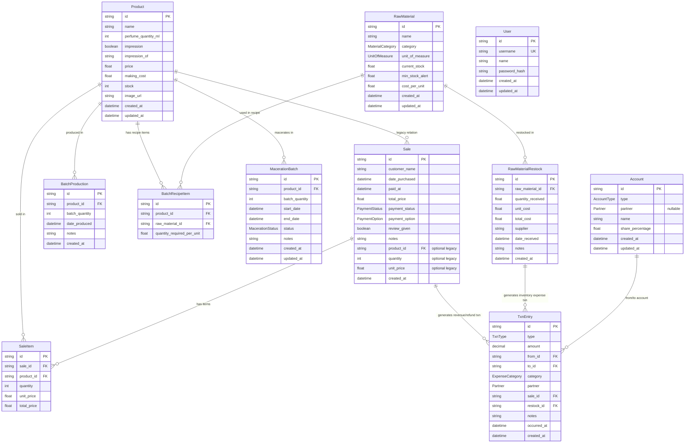

# Database Schema Documentation

## Database Technology: Neon PostgreSQL + Prisma ORM

This document specifies the database models, enums, relationships, and constraints for **Invento**.

Source of truth: [`prisma/schema.prisma`](../prisma/schema.prisma).

---

## 1. Entity Relationship Diagram (ERD)



---

## 2. Enums

### `PaymentStatus`
- `PENDING`: Order logged, payment not yet received.
- `PAYED`: Order payment received in full (triggers `REVENUE` transaction entry).
- `REFUNDED`: Order payment refunded to customer (triggers `REFUND` transaction entry).

### `PaymentOption`
- `CASH`: Cash on Delivery / Hand cash.
- `EASYPAISA`: Easypaisa mobile wallet transfer.
- `JAZZCASH`: JazzCash mobile wallet transfer.
- `BANK_TRANSFER`: Direct bank account deposit/IBFT.

### `MaterialCategory`
- `OIL`: Essential / Fragrance oils (measured in ml or grams).
- `SOLVENT`: Perfumer's ethanol / perfumery solvent (measured in ml).
- `BOTTLE`: Glass bottles (measured in pieces).
- `CAP_SPRAY`: Atomizer spray pumps and caps (measured in pieces).
- `STICKER`: Product labels & bottle stickers (measured in pieces).
- `BOX`: Outer packaging boxes (measured in pieces).
- `CARD`: Thank you / notes cards (measured in pieces).
- `OTHER`: Miscellaneous supplies.

### `UnitOfMeasure`
- `ML`: Milliliters
- `GRAMS`: Grams
- `PIECES`: Pieces / Count

### `MacerationStatus`
- `MACERATING`: Batch is aging; not yet in sellable stock.
- `COMPLETED`: Maceration period finished (transitional status; batches awaiting action remain `MACERATING` with a past `end_date` until acted on).
- `ADDED_TO_STOCK`: Batch released — bottles were incremented onto `Product.stock`.

### `Partner`
- `BADAR`: Founding partner (default 65% share).
- `HASHIR`: Founding partner (default 35% share).

### `AccountType`
- `BUSINESS`: The operational company wallet account.
- `PARTNER`: Personal drawing accounts for each partner.

### `TxnType`
- `CAPITAL_CONTRIBUTION`: Cash injected by a partner into the business account.
- `REVENUE`: Cash received into the business account from a paid sale.
- `REFUND`: Cash returned to a customer for a refunded sale.
- `EXPENSE`: Cash spent on inventory restocks or operating costs.
- `PROFIT_WITHDRAWAL`: Cash withdrawn by a partner from their earned profit balance.
- `LOAN_DISBURSEMENT`: Inflow of debt / financing capital.
- `LOAN_REPAYMENT`: Outflow repaying loan principal.

### `ExpenseCategory`
- `INVENTORY`: Restocks of raw materials (auto-posted by restock action).
- `ADS`: Marketing & social media ad campaigns.
- `RENT`: Studio / storage rent.
- `PACKAGING`: Secondary packaging, bubble wrap, mailer boxes.
- `UTILITIES`: Electricity, water, internet bills.
- `SALARY`: Staff or contractor wages.
- `TRANSPORT`: Delivery, courier fees, and fuel costs.
- `EQUIPMENT`: Production tools, crimping machines, beakers, scales.
- `BANK_INTEREST_FEES`: Bank account maintenance fees, payment processing fees, and loan interest.
- `OTHER`: Miscellaneous business expenses.

---

## 3. Models Overview

| Model | Purpose | Key behavior |
|-------|---------|--------------|
| `Product` | Finished perfume catalog | `stock` decremented on sale, incremented on production/maceration release; `making_cost` tracked for catalog valuation |
| `Sale` | Customer order header | Records customer, total price, payment status, payment option, notes, and review flag |
| `SaleItem` | Multi-product order line items | Multiple products & quantities per sale; handles atomic stock deductions and re-balances |
| `RawMaterial` | Manufacturing inputs | `current_stock` watched against `min_stock_alert` for low-stock warnings |
| `RawMaterialRestock` | "Got Supply" intake log | Created together with a `current_stock` increment and `cost_per_unit` refresh; logs auto `EXPENSE` |
| `BatchProduction` | Production run history | Written by both V1 (`produceBatch`) and V2 (`produceBatchV2`) |
| `BatchRecipeItem` | Per-bottle recipe (V1) | Unique per `(product_id, raw_material_id)`; replaced wholesale on recipe save |
| `MacerationBatch` | Aging batch tracking | Created by V2 production (maceration days > 0) or manually; released to stock via `addMacerationToStock` |
| `Account` | Ledger account entity | One `BUSINESS` account and one `PARTNER` account per partner with configurable `share_percentage` |
| `TxnEntry` | Immutable financial ledger entry | Double-entry money movement with idempotency keys (`sale_id`, `restock_id`), `occurred_at` period timestamp, and `Decimal(14,2)` precision |
| `User` | Authenticated team member | Encrypted salted bcrypt password hash, unique username, independent session tracking |

### Relationships & Constraints
- `Sale.items` cascade-delete with `Sale`.
- `SaleItem` links to `Product` with `onDelete: Cascade`.
- `Product.sales` uses `onDelete: SetNull` for legacy fields.
- `BatchProduction` and `MacerationBatch` cascade-delete with `Product`.
- `RawMaterialRestock` cascade-deletes with `RawMaterial`.
- `BatchRecipeItem` cascade-deletes with either side (product or raw material) with a composite unique on `(product_id, raw_material_id)`.
- `TxnEntry` links to `Account` (`from`, `to`), `Sale`, and `RawMaterialRestock` with `onDelete: SetNull`.
- Idempotency uniques: `@@unique([sale_id, type])` and `@@unique([restock_id, type])`.
- Unique constraint: `Account` on `@@unique([type, partner])`.
- Indexes:
  - `Sale(payment_status)`, `Sale(payment_option)`, `Sale(date_purchased)`, `Sale(paid_at)`
  - `SaleItem(sale_id)`, `SaleItem(product_id)`
  - `MacerationBatch(status)`, `MacerationBatch(end_date)`
  - `TxnEntry(type, occurred_at)`, `TxnEntry(from_id)`, `TxnEntry(to_id)`

---

## 4. Prisma Schema Code (`prisma/schema.prisma`)

```prisma
datasource db {
  provider = "postgresql"
  url      = env("DATABASE_URL")
}

generator client {
  provider = "prisma-client-js"
}

enum PaymentStatus {
  PENDING
  PAYED
  REFUNDED
}

enum PaymentOption {
  CASH
  EASYPAISA
  JAZZCASH
  BANK_TRANSFER
}

enum MaterialCategory {
  OIL
  SOLVENT
  BOTTLE
  CAP_SPRAY
  STICKER
  BOX
  CARD
  OTHER
}

enum UnitOfMeasure {
  ML
  GRAMS
  PIECES
}

enum MacerationStatus {
  MACERATING
  COMPLETED
  ADDED_TO_STOCK
}

model Product {
  id                  String   @id @default(uuid())
  name                String
  perfume_quantity_ml Int      // Volume in ml (e.g. 30, 50, 100)
  impression          Boolean  @default(false)
  impression_of       String?  // Name of designer scent if impression = true
  price               Float    // Sale price in PKR
  making_cost          Float    @default(0) // Cost to produce one bottle in PKR
  stock               Int      @default(0) // Ready-to-sell bottles
  image_url           String?  // Vercel Blob WebP URL
  created_at          DateTime @default(now())
  updated_at          DateTime @updatedAt

  sales               Sale[]
  sale_items          SaleItem[]
  batch_productions   BatchProduction[]
  recipe_items        BatchRecipeItem[]
  maceration_batches  MacerationBatch[]

  @@map("products")
}

model Sale {
  id             String        @id @default(uuid())
  customer_name  String
  date_purchased DateTime      @default(now())
  paid_at        DateTime?
  total_price    Float
  payment_status PaymentStatus @default(PENDING)
  payment_option PaymentOption @default(CASH)
  review_given   Boolean       @default(false)
  notes          String?

  created_at     DateTime      @default(now())

  // Legacy single-item fields kept optional for backward compatibility
  product_id     String?
  quantity       Int?          @default(1)
  unit_price     Float?

  product        Product?      @relation(fields: [product_id], references: [id], onDelete: SetNull)
  items          SaleItem[]
  txn_entries    TxnEntry[]

  @@index([payment_status])
  @@index([payment_option])
  @@index([date_purchased])
  @@index([paid_at])
  @@map("sales")
}

model SaleItem {
  id          String   @id @default(uuid())
  sale_id     String
  product_id  String
  quantity    Int      @default(1)
  unit_price  Float
  total_price Float

  sale        Sale     @relation(fields: [sale_id], references: [id], onDelete: Cascade)
  product     Product  @relation(fields: [product_id], references: [id], onDelete: Cascade)

  @@index([sale_id])
  @@index([product_id])
  @@map("sale_items")
}

model RawMaterial {
  id              String           @id @default(uuid())
  name            String
  category        MaterialCategory @default(OTHER)
  unit_of_measure UnitOfMeasure    @default(PIECES)
  current_stock   Float            @default(0) // Remaining ml/grams/pcs
  min_stock_alert Float            @default(10) // Threshold warning
  cost_per_unit   Float            @default(0) // Avg cost per unit in PKR
  created_at      DateTime         @default(now())
  updated_at      DateTime         @updatedAt

  restocks        RawMaterialRestock[]
  recipe_items    BatchRecipeItem[]

  @@map("raw_materials")
}

model RawMaterialRestock {
  id                String      @id @default(uuid())
  raw_material_id   String
  quantity_received Float
  unit_cost         Float
  total_cost        Float
  supplier          String?
  date_received     DateTime    @default(now())
  notes             String?

  created_at        DateTime    @default(now())

  raw_material      RawMaterial @relation(fields: [raw_material_id], references: [id], onDelete: Cascade)
  txn_entries       TxnEntry[]

  @@map("raw_material_restocks")
}

model BatchProduction {
  id             String   @id @default(uuid())
  product_id     String
  batch_quantity Int      // Number of finished bottles produced
  date_produced  DateTime @default(now())
  notes          String?
  created_at     DateTime @default(now())

  product        Product  @relation(fields: [product_id], references: [id], onDelete: Cascade)

  @@map("batch_productions")
}

model BatchRecipeItem {
  id                         String      @id @default(uuid())
  product_id                 String
  raw_material_id            String
  quantity_required_per_unit Float       // e.g. 15ml oil per bottle

  product                    Product     @relation(fields: [product_id], references: [id], onDelete: Cascade)
  raw_material               RawMaterial @relation(fields: [raw_material_id], references: [id], onDelete: Cascade)

  @@unique([product_id, raw_material_id])
  @@map("batch_recipe_items")
}

model MacerationBatch {
  id                   String            @id @default(uuid())
  product_id           String
  batch_quantity       Int               // Number of bottles in maceration
  start_date           DateTime          // When maceration started
  end_date             DateTime          // When maceration is expected to end
  status               MacerationStatus  @default(MACERATING)
  notes                String?
  created_at           DateTime          @default(now())
  updated_at           DateTime          @updatedAt

  product              Product           @relation(fields: [product_id], references: [id], onDelete: Cascade)

  @@index([status])
  @@index([end_date])
  @@map("maceration_batches")
}

// ==========================================
// FINANCE & BANKING SYSTEM
// ==========================================

enum Partner {
  BADAR
  HASHIR
}

enum AccountType {
  BUSINESS
  PARTNER
}

enum TxnType {
  CAPITAL_CONTRIBUTION
  REVENUE
  REFUND
  EXPENSE
  PROFIT_WITHDRAWAL
  LOAN_DISBURSEMENT
  LOAN_REPAYMENT
}

enum ExpenseCategory {
  INVENTORY
  ADS
  RENT
  PACKAGING
  UTILITIES
  SALARY
  TRANSPORT
  EQUIPMENT
  BANK_INTEREST_FEES
  OTHER
}

model Account {
  id               String      @id @default(uuid())
  type             AccountType
  partner          Partner?    // null on the BUSINESS account
  name             String
  share_percentage Float       @default(0) // e.g. 65 for Badar, 35 for Hashir
  created_at       DateTime    @default(now())
  updated_at       DateTime    @updatedAt

  outgoing         TxnEntry[]  @relation("From")
  incoming         TxnEntry[]  @relation("To")

  @@unique([type, partner])
  @@map("accounts")
}

model TxnEntry {
  id          String           @id @default(uuid())
  type        TxnType
  amount      Decimal          @db.Decimal(14, 2)  // always > 0; direction determined by from/to
  from_id     String?
  to_id       String?
  category    ExpenseCategory?                     // EXPENSE only
  partner     Partner?                             // CONTRIBUTION: who paid in; WITHDRAWAL: who was paid out
  sale_id     String?                              // idempotency key for REVENUE / REFUND
  restock_id  String?                              // idempotency key for inventory EXPENSE
  notes       String?
  occurred_at DateTime         @default(now())     // business date when cash moved
  created_at  DateTime         @default(now())

  from        Account?            @relation("From", fields: [from_id], references: [id], onDelete: SetNull)
  to          Account?            @relation("To",   fields: [to_id],   references: [id], onDelete: SetNull)
  sale        Sale?               @relation(fields: [sale_id], references: [id], onDelete: SetNull)
  restock     RawMaterialRestock? @relation(fields: [restock_id], references: [id], onDelete: SetNull)

  @@unique([sale_id, type])
  @@unique([restock_id, type])
  @@index([type, occurred_at])
  @@index([from_id])
  @@index([to_id])
  @@map("txn_entries")
}

// ==========================================
// USER AUTHENTICATION
// ==========================================

model User {
  id            String   @id @default(uuid())
  username      String   @unique
  name          String
  password_hash String
  created_at    DateTime @default(now())
  updated_at    DateTime @updatedAt

  @@map("users")
}
```

---

## 5. Seed Data (`prisma/seed.ts`)

Running `bun run seed` creates:

- **8 raw materials** — French Vanilla & Santal Oud oils, 99% denatured ethanol, 50ml glass bottles, atomizer sprays, logo stickers, packaging boxes, thank-you cards (each with stock, alert threshold, and unit cost).
- **3 products** — Velvet Oud (50ml, impression), Santal Dream (50ml, impression), Midnight Bloom (100ml, original).
- **3 finance accounts** — Business Account (`BUSINESS`), Badar's Account (`PARTNER`, default 65% share), and Hashir's Account (`PARTNER`, default 35% share).

Sales, maceration batches, and recipes are managed live through their respective application interfaces. Existing single-product sales can be backfilled into `sale_items` using `bun run migrate-sales`.
